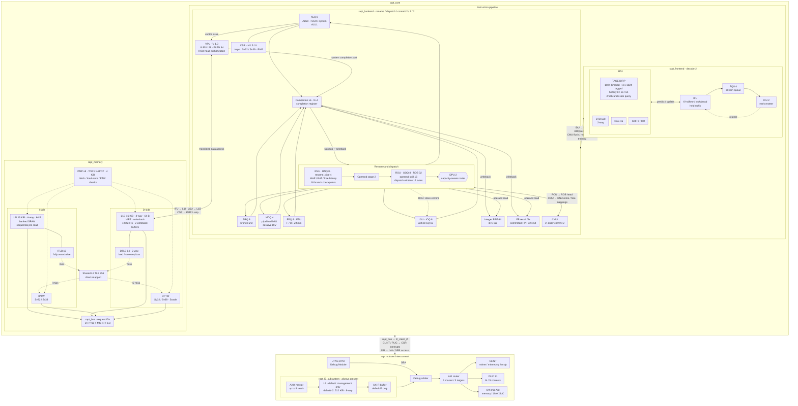

# Raptor Project

[](https://github.com/Kingfish404/raptor-chip/actions/workflows/benchmark.yaml) [](https://github.com/Kingfish404/raptor-chip/actions/workflows/app.yaml) [](https://github.com/Kingfish404/raptor-chip/actions/workflows/sta.yaml)

[](./docs/README.md#isa-scope) [](./docs/README.md#rva23u64-support) [](https://github.com/riscv/riscv-isa-manual) [](./docs/uarch.md) [](./fpga/) [](./LICENSE)

> It is possible to invent a single machine which can be used to compute any computable sequence. — Alan Turing, 1936

Raptor is a configurable **RV32/RV64 superscalar, out-of-order RISC-V core** with
register renaming, precise in-order retirement, TAGE prediction, scalar floating
point and an integrated vector unit. The SystemVerilog RTL uses a Chisel decoder
generator. The repository includes Verilator/NEMU simulation, OpenSBI/Linux
boot, FPGA integration and open-PDK synthesis and timing flows.

## ISA and profiles

| XLEN with the `default` preset | ISA | Application profiles | Virtual memory |
| --- | --- | --- | --- |
| RV32 | RV32IMAFDC + V 1.0 | RVI20U32 | Sv32 / Bare |
| RV64 (`-DRAPT_RV64`) | RV64IMAFDC + V 1.0 | [RVA23U64] user mode, [RVA22S64] supervisor mode | Sv39 / Bare |

[RVA23U64]: ./docs/README.md#rva23u64-support
[RVA22S64]: ./docs/README.md#rva22s64-support

The RV64 user profile adds Zvbb, Zvfhmin, Zvkt, Zfa, Zawrs and Ssnpm for Supm.
Both XLENs support Svade and Svinval. RV64 also supports Svpbmt.

`default`, `default-*` and `large` enable V 1.0 in both XLEN modes with
**VLEN=128 and ELEN=64**. The other presets leave V off by default.
`RAPT_NO_RVA23U64` selects baseline V on RV64. `RAPT_NO_VPU` selects
scalar execution. See the [ISA scope](./docs/README.md#isa-scope) for scalar
extensions, platform requirements and validation.

```
Core:       raptor-falcon (M/S/U, Linux-capable)
PMP:        8 usable entries, TOR / NAPOT, 4 KiB granularity, L-bit lockable
Interrupts: CLINT (mtime, mtimecmp, msip) + PLIC (31 sources, M/S contexts)

Core boundary: l2_client_if to the cluster-level rapt_l2_subsystem (always present).
Bus Interface: AXI4, XLEN-bit data/addr containers, 4-bit ID; up to 8 burst-capable reads.
               Writes use independent AW/W handshakes: single-beat stores and dirty-line words,
               multi-beat Zicboz CBO.ZERO. Without L2, RAPT_POSTED_WRITES bounds cacheable writes
               in flight (default 4). Write-through stores may complete at bus capture; buffered
               writebacks retain their data and complete only on the corresponding B response.
Addresses: 32-bit physical by default in both modes; RV64 RAPT_PADDR_BITS=32..38.
           RV64 stores PCs in 40 bits and sign-extends to XLEN; the PMA map stays 32-bit.
Default uarch: decode / rename / dispatch / commit = 2; 2 integer ALU ports, ROB=32,
               ALQ=8, BRQ=8, MDQ=4, FPQ=8, IOQ=8, SQ=16, 6 completion ports,
               16 branch checkpoints, integer PRF=64, committed FPR=32 x 64-bit.
Prediction: TAGE + 128-entry BTB + 16-entry RAS.
Caches: L1I/L1D = 16 KiB each, 4-way, 64 B lines; L1D write-back, 4 MSHRs,
        2 writeback buffers. ITLB=16; DTLB=64 (2-way, load/store replicas);
        shared L2 TLB=256. No L2 cache in default; default-l2 enables 512 KiB / 8 ways.

Verification: RISCOF / ACT4, directed and differential scalar/vector tests, RVFI and SVA.
```

Scalar F/D/Zfhmin operations use an out-of-order FPQ and ROB-backed FP renaming.
The 32 × 64-bit architectural FPR bank updates at retirement. Vector instructions
issue through the integer system path and execute under ROB-head ownership.
The VPU shares translation, protection and L1D with the scalar pipeline and
reports precise traps with `vstart` for restart. See the [VPU manual](./docs/vpu.md).

## Performance

Selected benchmark results for the configurations below. FPGA runs use a 50 MHz core.

| Environment | Preset / XLEN | CM/MHz | Embench-IoT | Geekbench 5 SC / MC |
| --- | --- | ---: | --- | ---: |
| Bare-metal sim | default / RV32 | 5.2173 | 1.6840x | — |
| Bare-metal sim | default / RV64 | 4.7743 | 1.7149x | — |
| Bare-metal sim | default-w4 / RV64 | 5.5781 | 2.0261x | — |
| FPGA Linux, KU5P | middle-cache / RV64 | 2.6422 | 1.0000x | — |
| FPGA Linux, KU15P, DDR UI 200 MHz | default-w4 / RV64 | 2.9395 | 0.9258x | 1 / 1 |
| FPGA Linux, KU15P, DDR UI 333 MHz | default-w4 / RV64 | 3.0947 | 1.0005x | 2 / 2 |

Sim uses measured ROI cycles, with Embench scaled to 50 MHz. Embench is the geometric mean
of speed across 19 passing workloads, relative to KU5P. Geekbench is 5.4.1 Preview, with one
hart in both single-core and multi-core modes.

## Microarchitecture

Sizes are for the `default` preset. See [Microarchitecture](./docs/uarch.md) for detailed
pipeline stages and block contracts. Boundary arrows name the connected blocks and signals.



## Setup & Quick Start

```shell
# Install the common development toolchain (FPGA/PDK setup is separate)
make setup
# or if just want to setup RTL workspace
make setup-rtl

# Show all available targets
make help
# or pack all SV files into one
make verilog pack

# Setup for IDE/LSP support
make compile-commands
```

### 1. NEMU (Software Emulator)

```shell
# Configure, build and run NEMU (riscv32)
make run-nemu32

# Or step by step
make build-nemu32           # configure and build
make run-nemu32             # run

# Interactive menuconfig
make menuconfig-nemu32
```

### 2. Simulation (Verilator)

```shell
# Full pipeline: generate RTL -> configure -> build -> run
make run-rv32

# Or step by step
make verilog              # Chisel -> SystemVerilog
make configure-rv32      # apply simulator configuration only
make build-rv32          # build Verilator simulator
make run-rv32            # run simulation

# Run with args
make run-rv32 ARGS="-b -n"    # -b: batch mode [default], -n: no wave trace
make run-rv32 IMG=path/to.bin  # load custom image
# Add reproducible 0..8-cycle delays to each AXI memory beat/response
make run-rv32 ARGS="-b -n --mem-random-delay=8 --mem-random-seed=1"
# Interactive menuconfig
make menuconfig-rv32
```

#### RV64 Mode

The processor supports RV64 via a compile-time switch (`-DRAPT_RV64`). RV32 and RV64 use separate configuration and model caches; no manual `make clean` is needed. See [simulator builds](sim/README.md).

```shell
# Build and run in RV64 mode (convenience targets)
make build-rv64
make run-rv64 ARGS="-b -n"
# Or explicitly pass VFLAGS
make run-rv32 VFLAGS="-DRAPT_RV64" ARGS="-b -n"
```

### 3. Benchmarks

```shell
# Run riscv32
make coremark-rv32 ARGS="-b -n"
make microbench-rv32 ARGS="-b -n"
# Run sim with reproducible random AXI memory delays (also supports -rv64)
make coremark-rv32 SIM_RANDOM_DELAY=31 SIM_RANDOM_SEED=1
make microbench-rv32 SIM_RANDOM_DELAY=31 SIM_RANDOM_SEED=42
# Run on ysyxSoC
make coremark-ysyxsoc ARGS="-b -n"
make microbench-ysyxsoc ARGS="-b -n"
# Run on NEMU (riscv32-nemu)
make coremark-nemu32 ARGS="-b -n"
make microbench-nemu32 ARGS="-b -n"
```

### 4. Applications running on riscv-pk

```shell
# Build and run hello world on NPC
make app-hello-rv32
# Build and run CoreMark on NPC
make app-coremark-rv32 ARGS="-b -n"
# Build and run Embench-IoT on NPC
make app-embench-rv32 ARGS="-b -n"
# Build riscv-pk (separate from the OpenSBI/Linux flow)
make app-pk-build
```

### 5. Linux Kernel Boot

```shell
# Boot Linux on NEMU (requires OpenSBI payload built first)
make linux-boot-nemu32
# Boot RV32GC Buildroot Linux on NEMU (downloads/re-wraps the image as needed)
make linux-boot-nemu32gc
# RV64GC equivalent
make linux-boot-nemu64gc
# Boot Linux on NPC (NEMU difftest is enabled by default)
make linux-boot-rv32
# See detailed instructions
# docs/linux_kernel.md, linux/README.md
```

### 6. Verification

```shell
# Random instruction fuzzing with difftest (NPC vs NEMU)
make verify-fuzz
make verify-fuzz-inf      # continuous until Ctrl-C / failure
# Signature-based ISA corner-case tests
make verify-sigtest
# RISCOF classic compliance tests (without difftest)
make verify-riscof-classic
make verify-riscof-classic-nemu
# Official RISCOF compliance (riscv-arch-test, sail reference)
make verify-riscof
# Verilator line/toggle coverage
make verify-coverage
# Run the lightweight fuzz + signature suites
make verify-light
# Inspect and run the parallel CoreMark, STA and FPGA regression
make regression-plan
make regression
# See verification/README.md for SVA, formal (RVFI), and ACT4 details
```

For integrated RVV and RVA23U64 checks, see the
[vector test commands](./docs/vpu.md#core-configuration-and-architectural-state)
and the [verification guide](./verification/README.md#architectural-programs-and-fuzzing).

### 7. FPGA

See [MLK-CU08-KU15P](fpga/mlk-cu08-ku15p/README.md) for the SystemVerilog SoC,
UART boot ROM, BRAM/DDR4 configurations and Vivado build commands. For example:
`make -C fpga/mlk-cu08-ku15p sim XLEN=64 MEMORY=bram`.

For **MLK-CU08 RV32/RV64 Linux with Ethernet and BIOS `netboot`**, follow the [paired build/load quick start](fpga/litex/README.md#cu08-rv32rv64-netboot-build-and-load) and then [TFTP bundle preparation](fpga/litex/NETBOOT.md). Ethernet is **disabled by default** (`WITH_ETHERNET=0`), including Linux CPU variants. A plain build therefore does not provide BIOS `netboot`. Build and load must use the same Ethernet settings and output directory; `fpga-load` loads an existing bitstream and does not rebuild it.

For the CU08 netboot profile, run from `fpga/litex`: `make fpga-netboot-rv32-build`,
then `make fpga-netboot-rv32-load`. Replace `rv32` with `rv64` for RV64. These paired
targets use the same Ethernet/CPU settings and isolated output directories; see
the linked guide for prerequisites, payload paths and TFTP setup.

```shell
# --- LiteX SoC ---
cd fpga/litex
make setup                          # one-time: install LiteX + register Raptor CPU
make pack                           # pack RTL into single .sv
make sim                            # Verilator sim with LiteX BIOS
make coremark                       # build + run CoreMark in sim
make embench                        # build + run all Embench-IoT benches
make linux32                        # build + run Linux payload in sim (make linux64 for RV64)

# Tang Mega 138K Pro hardware flow
make fpga-build BOARD=tang_mega_138k_pro # synth + P&R bitstream
make fpga-load BOARD=tang_mega_138k_pro  # load to SRAM (volatile)
make fpga-flash BOARD=tang_mega_138k_pro # write to external SPI flash
make fpga-console                   # open UART console

# MLK-CU08-KU15P Linux over Ethernet
make fpga-netboot-rv64-check RAPT_CONFIG=default
make fpga-netboot-rv64-build RAPT_CONFIG=default
# Follow the netboot guide to serve, load and boot the image.
```

## Build and Run (Manual)

> The following commands are equivalent to the `make` targets above,
> useful if you need finer-grained control.

```shell

# 0. environment variables for direct subdirectory workflows
source ./env.sh

# 1. build and run NEMU
cd $NEMU_HOME && make riscv32_defconfig && make && make run
cd $NEMU_HOME && make riscv32_linux_defconfig && make && make run

# 2. build and run NPC
cd $RAPTOR_HOME/tools/decodegen && make verilog
cd $NSIM_HOME && make o2_difftest_defconfig && make && make run
cd $NSIM_HOME && make o2linux_difftest_defconfig && make && make run
cd $NSIM_HOME && make menuconfig && make ARCH=riscv32-npc run

# 3. build and run the program you want

## n. running nanos-lite on nemu
cd $NAVY_HOME && make ISA=$ISA fsimg
cd $NAVY_HOME/apps/menu && make ISA=$ISA install
cd $RAPTOR_HOME/abstract-machine/app/nanos-lite && make ARCH=$ISA-nemu update run
cd $RAPTOR_HOME/abstract-machine/app/nanos-lite && make ARCH=$ISA-nemu run
## n.vme running nanos-lite on nemu with VME
cd $RAPTOR_HOME/abstract-machine/app/nanos-lite && make ARCH=$ISA-nemu update run ARGS="-b" VME=1

## n+1. running busybox on nemu (Linux required)
cd $NAVY_HOME/apps/busybox && colima ssh # login to Linux container
make ARCH=riscv32-nemu install

## 2n. running microbench/coremark on npc
cd $RAPTOR_HOME/abstract-machine/app/am-kernels/benchmarks/coremark_eembc && \
    make ARCH=riscv32-npc run ARGS="-b -n"
cd $RAPTOR_HOME/abstract-machine/app/am-kernels/benchmarks/microbench && \
    make ARCH=riscv32-npc run ARGS="-b -n"
# ARGS="-b -n" is optional, -b is for batch mode [default], -n is for no wave trace

## package all sv files into one
cd "$NSIM_HOME" && make pack
```

## Run Linux Kernel

See [Linux Kernel](./docs/linux_kernel.md)

## Reference

- [Specifications – RISC-V International](https://riscv.org/technical/specifications/)
- [riscv/riscv-isa-manual: RISC-V Instruction Set Manual](https://github.com/riscv/riscv-isa-manual)
- [riscv-software-src/riscv-unified-db: Machine-readable database of the RISC-V specification, and tools to generate various views](https://github.com/riscv-software-src/riscv-unified-db)
- ["一生一芯"](https://rapt.oscc.cc/)
