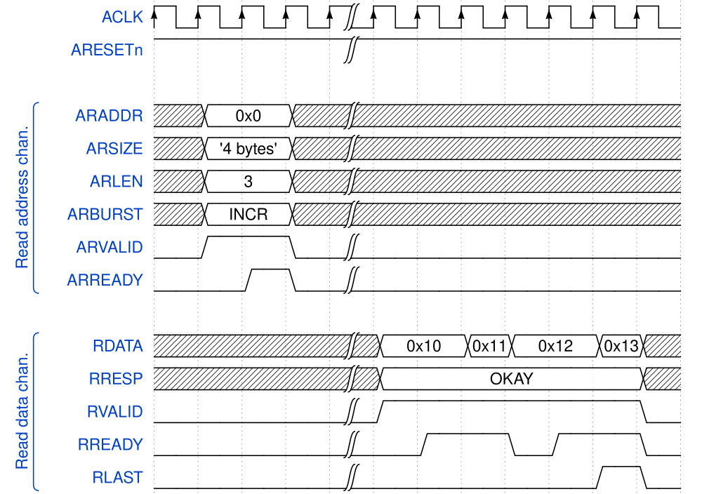
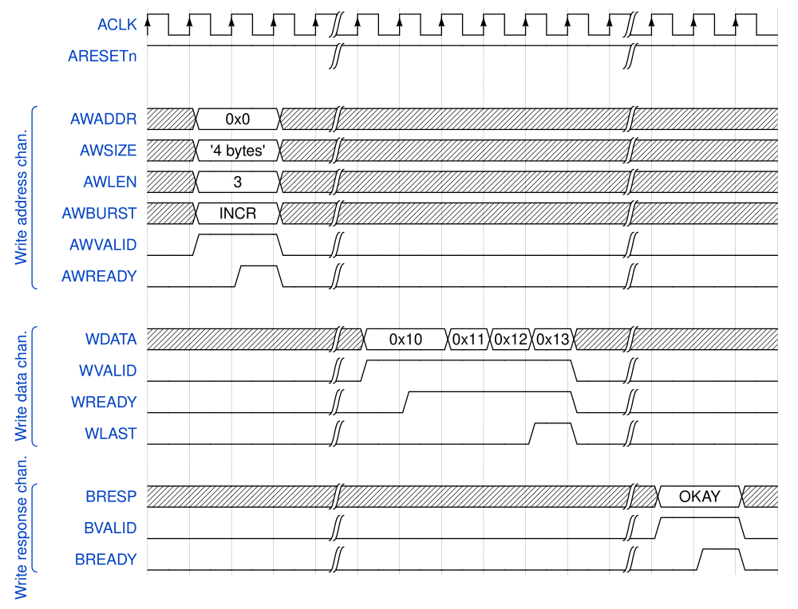

# Reference

Use these protocol references and diagrams when working on Raptor's AXI bus interface.
The public PPA benchmark link provides context for the open synthesis and timing flows.

## AXI(4) Interface

- [AXI protocol overview](https://developer.arm.com/documentation/102202/latest/AXI-protocol-overview)
- [AMBA AXI Protocol Specification](https://developer.arm.com/documentation/ihi0022/latest/)
- [Advanced eXtensible Interface](https://en.wikipedia.org/wiki/Advanced_eXtensible_Interface)

## PPA Benchmark

[PPA Benchmark](https://github.com/Kingfish404/yosys-opensta/tree/main/benchmark/results)
