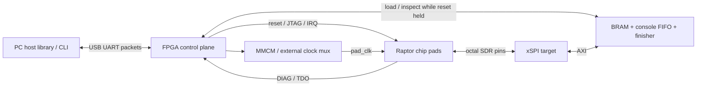

# Raptor returned-chip bring-up

## Direct silicon acceptance

`tools.bringup.silicon` uses a selected CMSIS-DAP probe and the existing native
DMI/SBA/Flash library. It never configures an FPGA. Supply, clock, reset and
interface electrical limits come from the reviewed board documentation.
Start with `--phase debug`; then run the full suite with known firmware:

```sh
export RUN_DIR=/path/outside/checkout/sample-001
make -C app/tests/silicon programs BUILD_ROOT="$RUN_DIR/programs" CLOCK_HZ=10000000
python3 -m tools.bringup.silicon --target silicon \
  --probe-serial "$PROBE_SERIAL" --board-serial "$BOARD_SERIAL" --chip-serial "$CHIP_SERIAL" \
  --openocd "$OPENOCD_EXECUTABLE" --clock-hz 10000000 --adapter-khz 100 \
  --output "$RUN_DIR/acceptance" --boot-bin "$RUN_DIR/programs/xip/xip-boot.bin" \
  --programs "$RUN_DIR/programs/ram" --gpio --scratch --backup "$RUN_DIR/originals"
```

The measured clock must match the firmware build. Keep TCK below core clock/8;
the initial acceptance profile also limits it to core clock/16 and 500 kHz.
`--openocd` accepts a single executable or wrapper path, including a separately
reviewed `sudo -n` wrapper. It does not interpret shell command strings.
The transport owns its OpenOCD child through a pipe lifeline: normal close,
driver signals and abrupt driver death trigger child cleanup. A privileged
wrapper must place the guard **after** `sudo` so it can terminate that child:

```sh
#!/bin/sh
exec sudo -n /usr/bin/python3 /path/to/checkout/tools/bringup/process_guard.py \
  --grace 2 -- /path/to/openocd "$@"
```

Keep the wrapper executable and its paths fixed for the reviewed run. Avoid a
session lifetime cap shorter than the entire phase using that connection.
Budget setup, acceptance, restoration and process cleanup separately; leave the
restoration budget available after an acceptance timeout.

| Profile | Hardware guard readbacks: storage / write start / end | Routine scratch |
| --- | --- | --- |
| `silicon` | `0 / 0 / 0x800000` | `0x10000`; first 64 KiB reserved for boot |
| `arty-native` | `0x800000 / 0x800000 / 0x1000000` | `0x810000`; lower partition immutable |

Guard mismatches stop the run. Silicon accepts only the fixed MT35XU256ABA or
W25Q64JW-IQ descriptor (`--flash-part`); the native fixture uses the former.
A larger Flash part does not expand the frozen chip's aperture. Scratch must
initially be blank: immutable backups include boot and both neighbours. Normal
completion restores the blank sector and compares protected data. An uncertain
operation preserves its in-flight marker and prevents automatic retry.
The routine never installs or changes the boot image; provision it separately
at the correct physical offset and verify it before supplying `--boot-bin`.

For a new silicon NOR, install the small boot image through the same probe:

```sh
python3 -m tools.bringup.provision --target silicon --probe-serial "$PROBE_SERIAL" \
  --board-serial "$BOARD_SERIAL" --chip-serial "$CHIP_SERIAL" --clock-hz 10000000 \
  --openocd "$OPENOCD_EXECUTABLE" --image "$RUN_DIR/programs/xip/xip-boot.bin" \
  --backup "$RUN_DIR/boot-originals" --output "$RUN_DIR/install" install
```

This explicit command owns only physical sector zero, accepts at most 4 KiB,
backs up original boot and neighbour sectors, and verifies every change. It
leaves the hart halted; apply shared chip/Flash reset to boot. Use the same
identity and backup with `restore` (omit `--image`) to restore the original
sector. Uncertain operations block replay and restoration. Arty guard readbacks
reject this offset-zero capability before any array write.

For a boot with no JTAG traffic, add `--uart1 "$UART1"` and
`--cold-reset-command /path/to/reviewed-shared-reset`. The executable resets
chip and Flash together. The suite closes OpenOCD, opens the UART receiver,
invokes that hook, requires a fresh boot message, then reconnects debug.
Add `--uart0 "$UART0"` for both physical UART directions, and optionally
`--irq-loopback` with an isolated GPIO2-to-IRQ jumper. The stock native fixture
ties IRQ low, so it cannot perform that external-wire test. `--gpio` requires
all three pins to be free of competing drivers.

Memory reads and writes use bounded standard SBA blocks inside OpenOCD. A
4 KiB read uses four Tcl requests, preserving per-word busy/error checks and
stopping exactly at the checked boundary. Flash commands keep the same range,
halt, ownership, backup and readback guards. No write is automatically replayed.
Per-word DMI JSON logging is off by default; `--dmi-trace` enables it and selects
the slower individual-DMI transport for diagnosis. The native, io25 and provision
commands accept the same flag. Each OpenOCD connection saves aggregate RPC/word
counts in `*.transport.json` beside its command and server logs.

Each step prints PASS, FAIL, SKIP or NOT_RUN. `result.json` and transport logs
remain outside the checkout; failure stops dependent actions. `pass` covers
requested automated checks; `complete` remains false when measurements or wire
tests are missing. Supply optional `--bench-json` with externally measured,
approved rail/current/clock observations. Voltage/frequency shmoo points use
separate externally controlled conditions and separate runs. See the
[diagnostic firmware notes](../app/tests/silicon/README.md) for the JSON schema,
simulation replay, test coverage and the small checked benchmark. Add
`--sim-openocd` to a native `--sim` run to exercise the actual OpenOCD Tcl block
path through the simulated JTAG pins. It uses a local remote-bitbang server and
opens no USB adapter. Simulation wall time is not a physical adapter benchmark.

## FPGA bridge fixture

The FPGA is the memory system and test instrument for `chip32-middle-16k` in
bridge mode. The same chip contains the FPGA bridge and [Flash backend](chip-flash.md).
The chip powers up in ROM-XIP. This bridge-only carrier uses JTAG/SBA to write
boot control `0` at `0x00100808`, then applies ndmreset and resumes into its board
ROM. IRQ is an ordinary interrupt input throughout. See the
[boot-control contract](chip.md#boot-control).
The bridge-mode chip resets to `0x2000_0000`. The board must already contain a boot
ROM and RAM image before releasing reset. Start at 10 MHz with link half period
15, then characterize faster operation. No board programming is part of the
build or simulation commands in this directory.

## Platform and limits

`fpga/bringup/rtl/rapt_bringup_top.sv` contains the board-neutral platform.
`fpga/bringup/cu08/rapt_bringup_cu08.sv` ports it to MLK-CU08-KU15P.
CU08 provides a documented FMC_C connector mapping with 1.8 V signaling and an
onboard USB UART. It has enough BRAM to test the chip independently of external
memory calibration. The mapping reuses contacts documented in
[`CM005-FMC-C.md`](../fpga/litex/CM005-FMC-C.md) and
[`CM005-BRIDGE.md`](../fpga/litex/CM005-BRIDGE.md); remove the Ethernet module.
Verify FMC_C's adjustable supply is **1.8 V** before connecting the carrier.
Do not infer its present voltage from FPGA I/O constraints.

This initial platform provides 64 KiB MROM, 512 KiB main RAM, and 8 KiB scratch
SRAM in BRAM. Memory survives chip reset; the console and finisher reset.
The existing CU08 DDR flow is separate: this design does not instantiate MIG,
run DDR calibration, provide storage/network devices, or boot Linux. The board
can support a later DDR extension through its existing flow. Linux needs that
extension, a suitable image/device tree and substantially more RAM. This port
does not control supply voltage, measure current, or guarantee analog link
margin. External instruments and the carrier supply controls provide those.

| Region | Base | Implemented size / behavior |
| --- | --- | --- |
| `sifive,test` | `0x0010_0000` | 4 KiB; sticky 32-bit result |
| Scratch SRAM | `0x0f00_0000` | 8 KiB |
| NS16550 console | `0x1000_0000` | byte registers, DLAB, IER/IIR, LCR, MCR, SCR, LSR |
| MROM | `0x2000_0000` | 64 KiB; host-loadable while reset is held |
| Main RAM | `0x8000_0000` | 512 KiB |

CLINT, PLIC and the debug module are on the chip. Other external addresses
return AXI DECERR. The local link divider at `0x0010_0800` stays inside the chip.
Boot control survives TAP/DM/core reset and is restored to ROM-XIP only by chip
reset. The host selects bridge boot after each chip reset and before checking
the DIAG heartbeat. IRQ needs no DIAG guard. Board reset still clears any
retained interrupt request.

The NS16550 TX path captures bytes in a 4096-byte FIFO for host polling. RX has
64 bytes. It identifies as a non-FIFO UART, so software must poll LSR. FCR FIFO
features and a console interrupt are not implemented; `pad_irq` is host driven.
LSR bits 5/6 indicate capture space, not physical baud-clock transmission.
The finisher accepts `0x5555` pass, `(exit_code << 16) | 0x3333` fail, and
`0x7777` reset-request observation. A reset request is reported as a nonzero
exit to the host; it does not reset the chip automatically.



In emulation, the chip-pad block sits inside the FPGA and programmable wire
delays connect it to the same target. The NS16550 console is memory mapped on
the FPGA and captured through the host UART; it requires no separate chip UART.

## FPGA connector

These are FPGA pins and FMC contacts, not chip connection positions. Connect
the chip carrier using signal names. All listed FMC signals use LVCMOS18;
FMC_C bank supplies 72 and 66 must both be 1.8 V. The public board mapping is
listed in the links above. All port-A contacts through `pad_jtag_tck` use bank 72;
`pad_jtag_tms`, `pad_jtag_tdi`, `pad_jtag_tdo`, `pad_diag` and `external_clock`
use bank 66. The board clock uses bank 65 at 1.8 V, reset button bank 64 at
1.8 V and the onboard USB UART bank 90 at 3.3 V. Never route UART voltage to
a chip signal.

| Chip/carrier signal | Direction at FPGA | FMC_C contact | FPGA pin |
| --- | --- | --- | --- |
| `pad_clk` | out | D20 | F18 |
| `pad_reset_n` | out | D21 | F17 |
| `pad_irq` | out | D14 | B15 |
| `pad_xspi_sclk` | in | C22 | L19 |
| `pad_xspi_cs_n` | in | C18 | D14 |
| `pad_xspi_dq[0]` | bidi | C15 | B16 |
| `pad_xspi_dq[1]` | bidi | C14 | B17 |
| `pad_xspi_dq[2]` | bidi | C11 | A18 |
| `pad_xspi_dq[3]` | bidi | C10 | A19 |
| `pad_xspi_dq[4]` | bidi | D18 | D15 |
| `pad_xspi_dq[5]` | bidi | D17 | E15 |
| `pad_xspi_dq[6]` | bidi | C23 | L18 |
| `pad_xspi_dq[7]` | bidi | C19 | C14 |
| `pad_jtag_tck` | out | D15 | A15 |
| `pad_jtag_tms` | out | G16 | E8 |
| `pad_jtag_tdi` | out | H29 | E13 |
| `pad_jtag_tdo` | in | H31 | C12 |
| `pad_diag` | in | H32 | B12 |
| `external_clock` monitor/source | in | G2 | G9 |

Board reference: `clk100` P26, reset button `cpu_resetn` AJ14,
USB UART FPGA RX AM11 and TX AN11. These ports are separate from the carrier.
Use FMC ground contacts adjacent to signal groups and multiple return pins.
Do not connect the carrier to the board's FPGA configuration JTAG pins.

## Build and run without a chip

Set `BRINGUP_WORK` to a large output disk outside the repository. Every build
requires an explicit output root. The build script fingerprints source inputs,
limits jobs to four and checks available memory before starting Vivado. Run
only one Vivado build at a time. No target programs hardware.

```sh
export BRINGUP_WORK=/path/to/large-disk/raptor-bringup
export PYTHONDONTWRITEBYTECODE=1
make -C fpga/bringup programs sim BUILD_ROOT="$BRINGUP_WORK" CROSS_COMPILE=riscv64-elf-
make -C fpga/bringup test
make -C fpga/bringup ram-test BUILD_ROOT="$BRINGUP_WORK"
make -C fpga/bringup clock-test BUILD_ROOT="$BRINGUP_WORK"
python3 -m tools.bringup --sim "$BRINGUP_WORK/sim/sim/bringup-sim" connect
python3 -m tools.bringup --sim "$BRINGUP_WORK/sim/sim/bringup-sim" \
  run "$BRINGUP_WORK/programs/programs/dummy.bin" --half 15
python3 -m tools.bringup.validate --sim "$BRINGUP_WORK/sim/sim/bringup-sim" \
  --programs "$BRINGUP_WORK/programs/programs" --output "$BRINGUP_WORK/acceptance.json"
make -C fpga/bringup emulation BUILD_ROOT="$BRINGUP_WORK" JOBS=4
make -C fpga/bringup hardware BUILD_ROOT="$BRINGUP_WORK" JOBS=4
```

The simulator instantiates the real `rapt_chip_pads` and the same platform. A
subprocess converts host bytes to UART waveforms, decodes UART replies, and
advances board clocks through transactions and explicit WAIT requests.
Simulation time pauses between PC requests. It never loads DUT memory directly,
reads internal chip state, or intercepts EBREAK. The AM cpu-tests are compiled
with their existing test sources and klib; a separate runtime uses the finisher
and a 512 KiB memory layout. They use RV32IM/Zicsr instructions. All code, stack,
BSS initialization and checking execute on the selected chip RTL.
The portable clock model uses its configured cycle source for either source
selection; the separate primitive test supplies an independent external oscillator.

In FPGA emulation the chip is internal behind the same pad module and the same
forward/reverse delay pipelines. Physical chip reset stays low and other
carrier outputs stay safe. The simulator and emulation delay setting is 0..15
board periods **per direction**, applied to SCLK, CS_N and all DQ wires, and to
return DQ/output-enable. This is a digital transport-delay model, not a model
of pad analog behavior, metastability, skew, or supply effects.

The current integration requires fresh implementation before FPGA use. Earlier
implementation results from another source snapshot do not qualify this port.
Review reset release, clock selection, Gray-counter constraints, protocol-stable
JTAG/DQ crossings and carrier timing individually; functional simulation does not
waive CDC findings or establish physical link margin.

## Host operations

Replace `--sim ...` with `--serial /dev/ttyUSBX` for hardware; the CLI/library
and packet format are identical. Hardware runs at 1 Mbaud 8N1. Simulation uses
eight board clocks per UART bit to shorten tests. One simulator subprocess is
one board session; separate CLI invocations start a fresh simulated board.
Use `Board(SimTransport(...))` to keep state across commands. Real UART board
state persists when the host disconnects.

```sh
python3 -m tools.bringup --serial /dev/ttyUSBX connect
python3 -m tools.bringup --serial /dev/ttyUSBX memory-test
python3 -m tools.bringup --serial /dev/ttyUSBX run program.bin --half 15 --clock 5
python3 -m tools.bringup --serial /dev/ttyUSBX idcode
python3 -m tools.bringup --serial /dev/ttyUSBX halt
python3 -m tools.bringup --serial /dev/ttyUSBX register 0x1001
python3 -m tools.bringup --serial /dev/ttyUSBX resume
python3 -m tools.bringup --serial /dev/ttyUSBX link-shmoo program.bin \
  --halves 2,3,4,5,6,7,8,9,10,11,12,13,14,15 --samples 0,1,2 --output link.json
python3 -m tools.bringup --serial /dev/ttyUSBX clock-shmoo program.bin \
  --clocks 6,5,4,3,2,1 --half 15 --output clock.json
python3 -m tools.bringup --serial /dev/ttyUSBX test /path/to/cpu-tests \
  --chip-serial example-001 --conditions '{"temperature_c":25}' \
  --output /path/to/results/example-001.json
python3 -m tools.bringup --serial /dev/ttyUSBX reset
```

`--clock N` selects `100 MHz / (2*N)`: 50, 25, 16.667, 12.5, 10 or 8.333 MHz.
The CU08 MMCM uses a 1 GHz VCO and DRP integer output divider; clock changes
require reset held and clock disabled. The host follows that sequence and waits
for lock. A BUFGCTRL gates/multiplexes the MMCM and external oscillator.
Source selection is rejected unless clock enable and reset release are already
both clear. Keep the old source running through clock shutdown before switching;
a stopped source can prevent a glitchless mux from completing the handoff. Supply
the external source on `external_clock`, then use `power-on --external`.
Its actual frequency is measured; check it against the oscillator specification.
The FPGA's core timing constraint covers 50 MHz and the external input assumes
at most 50 MHz. A routed timing failure limits emulation operating frequency.
The reference clock uses dedicated clock-backbone routing to reach the MMCM
beside the external clock's BUFGCTRL; no fabric-clock routing exception is used.

`input_taps` controls a common 0..511 IDELAYE3 COUNT setting on the eight incoming
DQ wires. COUNT mode is uncalibrated; record tap count, temperature and voltage,
and measure its physical span. There is no claimed picoseconds-per-tap value.
`sample_delay` adds 0..15 whole board clocks to incoming DQ relative to SCLK for
coarse sampling sweeps; SCLK/CS continue through the target's synchronizers.
Program both only with chip reset held. The library `run(..., taps=...)` exposes
fine input delay; CLI `--taps 0,64,128` sweeps it and `--samples` sweeps coarse delay.
Fine primitive tap delay is not modeled in the portable simulator.
The separate `clock-test` uses Icarus and the selected Vivado's actual MMCM and
BUFGCTRL simulation primitives to exercise all six DRP dividers and the external
source. `build.py clock-test --clock-sim xsim` selects XSim instead.

The target launches three board clocks after a falling SCLK. Allow for that
latency plus outbound/return board delay before shortening the chip half period.
Status polling can absorb a whole response-byte delay, so a symmetric transport
delay alone need not produce one monotonic failure edge. The acceptance model
uses 60 ns in each direction at 25 MHz and DQ sample offsets 0, 60 and 100 ns.
The chip launches request data one core cycle into the low phase. Expected
minimum passing half periods are 2, 3 and 4 respectively; the offset models
additional DQ skew relative to SCLK. Actual matrices belong in result files.
Sweep both directions, repeat and test data patterns as well as boot success.
A single passing point is not timing margin.

## Ordered bring-up and diagnosis

1. **Unpowered inspection and supplies.** Verify named supply continuity, ground,
   no supply shorts and I/O bank voltage. Start with clock disabled and reset
   actively held low. Use current-limited core and I/O supplies set to the chip
   team's approved values;
   log voltage at the carrier and quiescent current. Confirm the chip team's
   approved ramp/order and limits before applying power. Pass: both rails in
   their approved windows, stable power-good, and no abnormal current/heating.
   Failure points to assembly, rail ties, a short, sequencing or the device.
2. **Clock and reset.** Confirm FPGA UART identity, hold reset, enable a slow
   clock, and measure the FPGA clock counter. DIAG's driver is released during
   reset, so its heartbeat cannot be checked before release. Load a valid ROM
   and RAM payload, enable link, release reset, select bridge boot through JTAG,
   apply ndmreset, resume, then measure DIAG.
   Pass: counter
   and DIAG-derived core frequency agree within 1%, DIAG = core/1024. Missing
   counter activity points to clock selection/gating; counter working but no
   DIAG points to reset, connectivity, output power or the chip clock path.
3. **JTAG.** Keep TCK below core clock/8; the default 64-board-clock half period
   is safe across the supported clock range. Pass: IDCODE `0x10001913`, DTMCS
   version/abits, DM activation, halt acknowledgment, x0=0, plausible DPC and
   resume acknowledgment. Reset the TAP with six TMS-high cycles. A bad IDCODE
   suggests TMS/TDI/TDO wiring or timing; good IDCODE but no DM access suggests
   activation, TAP instruction or debug handshake failure. There is no TRST.
4. **Slow link.** Boot at the reset divider 4, immediately set divider 15 in
   the MROM trampoline, and keep the core slow enough that reset-divider fetch
   works. Pass: target sees frames/bytes/status polls, no watchdog/error count
   increase, and a known finisher payload passes. Failures isolate SCLK/CS/DQ
   direction, turnaround, sampling, boot ROM contents or memory map. A frame
   timeout asserts chip reset, releases FPGA DQ and resets target AXI state;
   write control with reset held to clear the fault before retrying.
5. **Memory.** Run host walking/address/data patterns with reset held, then
   chip-executed load/store, byte-lane, alignment and cache writeback tests.
   Pass: exact readback with no aliases, no link errors, and finisher pass.
   Host-only success does not prove the chip/link/caches. Failures distinguish
   memory decoding, DQ lanes, burst/strobe handling and cache behavior.
6. **cpu-tests.** Run all 35 AM cpu-test sources with the finisher runtime.
   Pass: all exit zero, no timeout, no lost console bytes. Keep one JSON per
   chip, recording software/source identity and conditions. Failures after
   memory checks suggest execution, exceptions, arithmetic or a corner-case
   memory operation; reduce to a small reproducer and capture waveforms in
   simulation. Do not silently patch frozen chip RTL.
7. **CoreMark and microbenchmarks.** Use a BRAM-sized image with a finisher,
   known reference output and fixed seeds. Record elapsed cycles, core clock,
   link divider/delays, compiler flags, cache warmup and memory footprint.
   Pass: validated output and repeatable cycles. Examine code/data/cache miss
   effects before interpreting low scores as a core frequency problem.
8. **Linux if memory allows.** This BRAM build stops before this step. After a
   separately validated DDR extension, test calibration and full RAM first,
   provide an accurate RAM/console/CLINT/PLIC device tree, then boot a minimal
   RV32 image and verify timer, console and memory stress. Pass: shell and
   repeatable stress without corruption. Do not count boot messages as a pass.
9. **Frequency and voltage shmoo.** Keep the link slow initially. At each
   approved rail setting, hold reset, change clock, check frequency, reload
   and run the same deterministic workloads. Record pass/fail by measured
   voltage, frequency and temperature. Voltage changes are manual/external;
   the CLI does not drive regulators. Stay inside chip-team approved limits.
   A failure that follows link settings suggests an I/O limit; a failure that
   follows core clock with a wide link margin suggests the core or supply.
10. **Link margin.** At several passing core frequencies, sweep half periods
    15 down to 2, coarse sample offset and fine COUNT taps. Exercise randomized
    data/address patterns and long bursts, repeat at approved voltage and
    temperature corners, and log frame/byte/poll/timeout/error deltas. Pass:
    a repeatable contiguous region with a documented guard band. Missing or
    pattern-dependent margin points to skew, termination, direction turnaround,
    supply integrity or FPGA input/output timing. Board STA alone cannot prove it.

## Carrier PCB requirements

- Provide separately controllable **core supply**, **I/O supply** and ground by
  signal/net name, with voltage and current limits supplied by the chip team.
  Tie **every connection of the same supply net name together
  on the carrier**, using a low-impedance plane; do not leave repeated supply
  connections isolated. Use separate current-sense points for core and I/O,
  Kelvin voltage test points, current limits and power-good monitoring.
- Obtain the permitted ramp order, ramp rates and off-state I/O conditions
  from the chip team. Keep reset asserted and all driven chip signals isolated
  until supplies are valid; stop/isolated clocks before removing power. Prevent
  back-powering through the FMC pins. A supervisor or carrier gate must keep
  reset low while the FPGA is unconfigured, since the chip has a reset pull-up.
  Keep `pad_irq` at a defined level and coordinate independent carrier resets
  with the FPGA fixture's IRQ guard. IRQ is an ordinary interrupt input in
  both backends; it does not select the boot mode.
- Place local high-frequency decoupling at each named supply connection and
  bulk decoupling near the carrier power entry. Select values and placement
  using measured transients and the approved power requirements.
- All chip signaling is 1.8 V LVCMOS. Use 1.8 V compatible buffers or explicit
  translation where necessary; never expose a chip input to 3.3 V USB UART or
  FPGA configuration/JTAG signals. Provide safe isolation/OE defaults.
- Include source-series termination footprints on `pad_xspi_sclk` and all
  `pad_xspi_dq[7:0]`. DQ is bidirectional: provide footprints at both ends and
  fit values from signal-integrity measurements. Avoid stubs; keep return
  paths continuous. Match the DQ group lengths and document SCLK-to-DQ skew;
  derive the allowed mismatch from the measured sampling budget.
- Provide low-capacitance test points for `pad_clk`, `pad_reset_n`, `pad_irq`,
  `pad_xspi_sclk`, `pad_xspi_cs_n`, DQ, JTAG and `pad_diag`, plus nearby grounds.
  Use probes that do not consume the link's timing margin.
- Provide an exclusive clock-source jumper/mux: FPGA `pad_clk` or a carrier
  oscillator. To use FPGA selection/counter verification, route the oscillator
  to FMC `external_clock` and let the BUFGCTRL drive `pad_clk`. A direct
  oscillator bypass must isolate FPGA `pad_clk` and is outside that counter's
  observation; DIAG still verifies the actual chip clock after reset release.
- Provide a labeled 1.8 V JTAG header with `pad_jtag_tck`, `pad_jtag_tms`,
  `pad_jtag_tdi`, `pad_jtag_tdo`, I/O reference and ground. Do not drive the
  header and FPGA master simultaneously. Keep clock running for JTAG and use
  TMS for TAP reset. Preserve the specified input pulls and reset supervision.
- Use the FMC_C signal table above and explicit ground returns. Do not tie
  core power to an FMC I/O rail. Verify carrier continuity and FPGA-bank
  voltages before mating it to a powered board.

## Control protocol and register map

Requests/replies contain 16 bytes, little endian:
`magic:u8, op:u8, sequence:u8, status:u8, address:u32, data:u32, aux:u16, crc:u16`.
Request magic is A5; reply magic is 5A. CRC16-CCITT uses polynomial 1021,
initial FFFF over bytes 0..13; CRC is little endian. Reply echoes op, sequence,
address and aux. Request status must be zero. Status 1 means bad CRC/header,
2 unknown operation/address/alignment, 3 unsafe change. Only one request may
be outstanding. Partial requests expire after 200 UART bit periods of silence.
There are no automatic write retries: after a transport fault, reconnect,
resynchronize and explicitly hold reset before recovering.

Ops: 1 read aligned word, 2 write aligned word, 3 wait `data` board cycles,
4 clock 1..32 JTAG bits (`aux` count, `address` TMS, `data` TDI, result TDO,
all LSB first). JTAG always finishes TCK low. Addresses below 0x1000 select
board registers; larger addresses access memory, only while chip reset is held.
Host loading verifies every word. Program loading into a live cached chip is
rejected. Link/sample/clock changes follow the same reset requirement.
Accepted control writes holding reset clear bit 3. After reset release is
requested, IRQ-high requests before a fresh DIAG period return unsafe status 3.
Status bit 4 is the readiness indication. `Board.irq`
and the `irq` CLI command enforce the same guard. Use matching updated board and
host software; an older board with no readiness bit fails the host power-on check.
Rejected clock-source/reset writes leave watchdog faults latched and chip reset held.

| Offset | Access | Meaning |
| --- | --- | --- |
| 00 | R | `0x52504231`, protocol RPB1 |
| 04 | RW | bit 0 clock enable, 1 reset release, 2 link enable, 3 IRQ, 4 external clock |
| 08 | RW | core half ticks 1..6; clock off/reset held |
| 0c | RW | coarse DQ sample delay 0..15 board periods |
| 10 | RW | common input IDELAY COUNT taps 0..511 |
| 14 | RW | maximum active frame duration; default 1,000,000 board cycles |
| 18 | R | bits 0 lock, 1 fault, 2 link, 3 reset released, 4 bridge IRQ ready |
| 1c / 20 | R | last DIAG rising-edge period in board cycles / number of rising edges |
| 24 | R | Gray-synchronized actual chip-clock edge counter |
| 28 / 2c | R | cumulative frame / wire-byte counters |
| 30 / 34 / 38 | R | status polls / frame timeouts / AXI error-response beats |
| 3c | R | main RAM capacity in bytes |
| 40 | R | sticky raw finisher word |
| 44 | R/pop | bit 8 console byte valid; bits 7:0 byte |
| 48 | W | enqueue console RX byte if RX has room |
| 4c | R | dropped console TX bytes |
| 50 | RW | JTAG half period, board cycles; minimum 64 |
| 54 | RW | emulation transport delay, 0..15 board periods per direction |
| 58 / 5c | R | chip count snapshot / timestamp captured by reading 58 |

Counters wrap at 32 bits and reset on board reset, not between programs.
Read baseline/delta for each test. Watchdog clear requires writing control
with reset held. Missing SCLK pulses alone are not a timeout: a frame must
remain active beyond the configured maximum. Read-frequency accuracy includes
synchronizer quantization and the board reference oscillator's tolerance.
